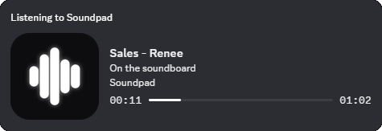

# soundpad-rpc

[](https://github.com/why4m3/soundpad-rpc/actions/workflows/test.yml)


[](LICENSE)

**English** | [Русский](README.ru.md)

[](https://github.com/why4m3/soundpad-rpc/releases/latest)

<p align="center"></p>

Spotify-style Discord Rich Presence for [Soundpad](https://leppsoft.com/soundpad/). While a sound is playing, your Discord profile shows:

```
Listening to Soundpad
Oh my                           <- sound title (details)
Memes                           <- Soundpad category (state)
0:02 ━━━━━━━●────────── 0:07    <- progress bar
```

## Features

- **Listening** activity type with a live progress bar that follows Soundpad's real playback position.
- Pause keeps the activity but hides the bar and shows a "paused" line (or hides it completely, configurable).
- Switching sounds, seeking and resuming update the presence; stopping or closing Soundpad clears it.
- Survives Soundpad and Discord restarts, reconnects automatically.
- Respects Discord's rate limit (5 updates per 20 s) and only sends changes.
- **Zero dependencies.** Plain Node.js 20+, its own tiny Discord IPC client, no `npm install`.
- Runs hidden in the background with optional autostart. Practically no CPU usage.
- Writes a small state file so other presence apps can step aside while a sound plays (see below).

## Installation

### Download (recommended)

No Node.js or git needed.

1. Download `soundpad-rpc-vX.Y.Z-win-x64.zip` from [Releases](https://github.com/why4m3/soundpad-rpc/releases/latest) and unpack it anywhere, e.g. `C:\Tools\soundpad-rpc`.
2. Run `windows\run-console.cmd`, play a sound in Soundpad and check your Discord profile.
3. When it works, run `windows\install-autostart.cmd` so it starts hidden with Windows.

No Discord application is needed: by default it uses the shared "Soundpad" app. To change the picture or the name, see [Picture and name](#picture-and-name).

Windows SmartScreen may warn about an unknown publisher because the exe is not code-signed: **More info → Run anyway**. The exe is built by GitHub Actions straight from this repository ([release workflow](.github/workflows/release.yml)).

The same Discord and Soundpad requirements apply: **User Settings → Activity Privacy → Share my activity** on, desktop Discord, full version of Soundpad.

### From source

1. Install **Node.js 20 or newer** from [nodejs.org](https://nodejs.org) (LTS).
2. Clone the repository:
   ```
   git clone https://github.com/why4m3/soundpad-rpc.git C:\Tools\soundpad-rpc
   ```
3. Run `windows\run-console.cmd`. On the first run it creates `config.json` from `config.example.json`.
4. In Discord: **User Settings → Activity Privacy → Share my activity** must be on. Only the desktop app works, not the browser version.
5. Soundpad must be running. The Remote Control API is available in the full version (it may be missing in the demo). Check with `node index.js --diagnose`.

### Picture and name

**Your own picture.** Put a direct link to any image into `config.json`, no Discord application needed:

```json
"large_image": "https://example.com/my-picture.png",
```

**Your own name** after "Listening to" (and pictures uploaded to Discord) needs your own Discord application:

1. Open the [Developer Portal](https://discord.com/developers/applications) and click **New Application**. Its name is what Discord shows after "Listening to".
2. Copy the **Application ID** from **General Information** into `config.json` as `client_id`.
3. For pictures: **Rich Presence → Art Assets → Add Image(s)**, upload a square PNG/JPG (512×512 or larger, e.g. the bundled [`assets/logo.png`](assets/logo.png)) and name it `soundpad`, or any other key you then put into `large_image`. New assets can take 5–15 minutes to appear.
4. Optionally add a second asset (e.g. `paused`) and set `"small_image_paused": "paused"`.

## Usage

| What | How |
| --- | --- |
| Run with a console window and log | `windows\run-console.cmd` or `node index.js` |
| Run hidden in the background | double-click `windows\start-hidden.vbs` |
| Stop the background process | `windows\stop.cmd` |
| Print what would be sent, without Discord | `node index.js --dry-run` |
| Dump raw Soundpad API answers | `node index.js --diagnose` |
| Show a 30 s test activity in Discord | `node index.js --test-discord` |
| Verbose log | add `--debug` |
| Print the version | `--version` |

With the release build use `soundpad-rpc.exe` instead of `node index.js`.

The log goes to `soundpad-rpc.log` and rotates at 1 MB. A second instance exits immediately.

### Autostart

```
windows\install-autostart.cmd
```

Creates a shortcut in the Startup folder that launches the app hidden, and starts it right away. To use a Task Scheduler "at logon" task instead:

```
powershell -ExecutionPolicy Bypass -File windows\install-autostart.ps1 -Task
```

Remove with `windows\uninstall-autostart.cmd`.

## Configuration

`config.json` is created from `config.example.json` on first run and supports `//` comments.

| Key | Default | Description |
| --- | --- | --- |
| `client_id` | `""` | Own Application ID; empty uses the shared "Soundpad" app |
| `poll_interval_ms` | `1000` | Soundpad polling interval, ms (250–60000) |
| `activity_type` | `2` | 2 Listening, 0 Playing, 3 Watching, 5 Competing |
| `status_display_type` | `2` | Line under your name: 0 app name, 1 state, 2 details. `null` omits the field |
| `details` / `state` | `{title}` / `{category}` | Line templates: `{title}` `{file}` `{artist}` `{category}` |
| `default_category` | `Soundpad` | Second line when the sound has no category |
| `unknown_title` | `Soundpad` | First line when the sound can't be identified |
| `show_when_paused` | `true` | `false` hides the activity on pause |
| `paused_state` | `На паузе` | Second line while paused (set to `Paused` for English) |
| `large_image` / `large_text` | `soundpad` / `Soundpad` | https link to a picture, or an Art Asset key of your own app; tooltip |
| `small_image_paused` | `""` | Small icon shown on pause |
| `ignored_categories` | `All sounds`, ... | Categories never shown |
| `state_file` | `""` | State file path, default `%LOCALAPPDATA%\soundpad-rpc\state.json` |
| `log_file` | `soundpad-rpc.log` | Log file, empty string disables it |
| `soundpad_pipe` | `\\.\pipe\sp_remote_control` | Soundpad pipe |
| `discord_pipe` | `""` | Specific Discord pipe, default tries `discord-ipc-0..9` |
| `discord_retry_ms` | `15000` | Discord reconnect interval |

## How the current sound is detected

Soundpad's Remote Control API reports play status, position and duration, but **has no "what is playing" command**. soundpad-rpc infers it, in this order:

1. **Play counters.** It keeps the `GetSoundlist()` snapshot and looks for the sound whose `playCount` changed and whose duration matches.
2. **Window text.** If `GetTitleText()` or `GetStatusBarText()` contains a sound name, that wins.
3. **Same sound** (repeat or seek to start) when the duration matches.
4. **Duration + recency.** Among sounds with the same duration, the most recently played one.

Weak matches (3–4) are re-checked after 2.5 s in case Soundpad updates counters late. The log shows which method was used.

## Playing nicely with other Rich Presence apps

Each Application ID has its own activity, so Soundpad's status can coexist with others. Discord picks the "main" one shown under your name by activity type: **Playing** ranks above **Listening**, which ranks above **Watching**. There is no priority field.

To keep Soundpad on top while a sound plays, another presence app can temporarily switch itself to Watching or clear its activity. soundpad-rpc writes `%LOCALAPPDATA%\soundpad-rpc\state.json` on every change:

```json
{ "active": true, "status": "PLAYING", "title": "Oh my", "ends_at": 1761300000000, "pid": 1234 }
```

A drop-in reader with no dependencies lives in [`integrations/claude-rpc/soundpad-state.cjs`](integrations/claude-rpc/soundpad-state.cjs):

```js
const { isSoundpadActive } = require('./soundpad-state.cjs');

const demote = isGameRunning() || isSoundpadActive();
// demote ? Watching (3) : Playing (0)
```

It treats a dead `pid` or an expired `ends_at` as inactive, so a crashed soundpad-rpc never blocks the other app.

## Development

```
npm test
```

42 tests on the built-in `node:test` runner, with fake Soundpad and Discord pipe servers, so neither app is needed. They cover the Soundpad protocol parser, sound detection, presence building, Discord IPC framing and handshake, reconnects, rate limiting and the full play → pause → seek → switch → stop cycle.

```
index.js                  entry point, CLI modes, single instance lock
src/soundpad-protocol.js  Soundpad API response parsing (pure functions)
src/soundpad-client.js    Soundpad named pipe: command queue, timeouts
src/discord-ipc.js        Discord IPC: framing, handshake, SET_ACTIVITY, PING/PONG
src/presence.js           sound detection and activity building
src/app.js                polling loop, rate limit, state file
src/state-file.js         state.json writer
integrations/             helper for other presence apps
windows/                  hidden start, autostart, stop scripts
test/                     node:test suites and fixtures
```

### Building the exe

```
npm i --no-save esbuild@0.25.0 postject@1.0.0-alpha.6 rcedit@4.0.1
node scripts/build-exe.js
```

This bundles the app into a [Node.js single executable](https://nodejs.org/api/single-executable-applications.html) in `dist/soundpad-rpc/`. Publishing a GitHub release (tag `vX.Y.Z` matching `package.json`) runs the same build on GitHub Actions and attaches the zip to it.

Soundpad commands follow Leppsoft's official `SoundpadRemoteControl.java` reference.

## License

[MIT](LICENSE)
